  <!-- ========================================================================= -->
  <!-- 🌟 HERO BANNER (ANIMATED CYBERPUNK VECTOR)                                -->
  <!-- ========================================================================= -->
  

    

  <!-- ========================================================================= -->
  <!-- ⚡ DYNAMIC ANIMATED TYPING SVGs                                           -->
  <!-- ========================================================================= -->
  

   

  <!-- ========================================================================= -->
  <!-- 🚀 LIVE METRICS & STATUS BADGES                                           -->
  <!-- ========================================================================= -->
  

    
    &nbsp;
    
    &nbsp;
    
    &nbsp;
    
  

  <!-- ========================================================================= -->
  <!-- 💬 DEVELOPER PHILOSOPHY / QUOTE                                           -->
  <!-- ========================================================================= -->
  

    <em>✨ "Architecting resilient distributed backend systems &amp; intuitive mobile experiences with precision, curiosity, and code." ✨</em>
  

<!-- ANIMATED CYBER DIVIDER -->

  

<!-- ========================================================================= -->
<!-- 🚀 SECTION: ABOUT ME & TERMINAL DIAGNOSTICS                               -->
<!-- ========================================================================= -->
 

<table width="100%" border="0">
  <tr>
    <td width="53%" valign="top">
      <h2> About Me &amp; Engineering Journey</h2>
      

        Hi there! 👋 I'm <b>Bhaskar Acharjee</b>, a <b>Java Backend Developer at TCS (Tata Consultancy Services)</b> and a seasoned <b>Mobile Application Developer</b> with <b>5+ published applications on the Google Play Store</b>. I graduated with a <b>B.Tech in Electronics &amp; Communication Engineering</b> from <a href="https://jgec.ac.in" target="_blank"><b>Jalpaiguri Government Engineering College (JGEC)</b></a>, West Bengal, India.
      

      

        My engineering passion lies at the intersection of <b>high-throughput backend microservices</b>, <b>reactive mobile application architecture</b>, and <b>interactive 3D web graphics</b>.
      

      <ul>
        <li>💼 <b>Enterprise Java @ TCS:</b> Engineering fault-tolerant backend services, RESTful microservices, and database pipelines handling mission-critical business logic.</li>
        <li>📱 <b>Mobile App Architect:</b> Designed and deployed <b>5+ production Android apps</b> on the Google Play Store leveraging <code>Kotlin</code>, <code>Java</code>, <code>Jetpack Compose</code>, <code>Room/SQLite</code>, and <code>Clean MVVM Architecture</code>.</li>
        <li>🌐 <b>Full-Stack &amp; 3D Creative:</b> Building modern interactive web interfaces with <code>React</code>, <code>TypeScript</code>, <code>TailwindCSS</code>, and <code>Three.js (3D Room &amp; TShirtify)</code>.</li>
        <li>📊 <b>Data Insights &amp; Analytics:</b> Turning raw unstructured data into actionable strategic intelligence using <code>Python</code>, <code>Pandas</code>, <code>NumPy</code>, <code>Power BI</code>, and <code>Jupyter Notebook</code>.</li>
        <li>⚡ <b>Engineering Mindset:</b> Clean code, defensive programming, automated test coverage, and continuous performance benchmarking.</li>
      </ul>
    </td>
    <td width="47%" valign="middle" align="center">
      <!-- LIVE ANIMATED TERMINAL SIMULATOR -->
      
    </td>
  </tr>
</table>

 

<!-- ANIMATED CYBER DIVIDER -->

  

<!-- ========================================================================= -->
<!-- 🛠️ SECTION: TECH ARSENAL & SKILLS                                         -->
<!-- ========================================================================= -->
 

<h2>🛠️ Tech Arsenal &amp; Weaponry</h2>

A comprehensive overview of my daily technologies, libraries, cloud infrastructure, and developer toolchain:

<table width="100%">
  <thead>
    <tr>
      <th width="28%" align="left">Domain</th>
      <th width="30%" align="left">Visual Stack</th>
      <th width="42%" align="left">Core Technologies &amp; Frameworks</th>
    </tr>
  </thead>
  <tbody>
    <tr>
      <td><b>☕ Backend &amp; Distributed Systems</b></td>
      <td>
        
      </td>
      <td>
        <code>Java (17+)</code>, <code>Spring Boot</code>, <code>Node.js</code>, <code>Express</code>, <code>RESTful APIs</code>, <code>Microservices</code>, <code>WebSockets</code>
      </td>
    </tr>
    <tr>
      <td><b>📱 Mobile App Development</b></td>
      <td>
        
      </td>
      <td>
        <code>Kotlin</code>, <code>Java</code>, <code>Android SDK</code>, <code>Jetpack Compose</code>, <code>Room / SQLite</code>, <code>Google Play Console</code>
      </td>
    </tr>
    <tr>
      <td><b>💻 Core Programming Languages</b></td>
      <td>
        
      </td>
      <td>
        <code>Java</code>, <code>Kotlin</code>, <code>Python</code>, <code>C++</code>, <code>C</code>, <code>JavaScript</code>, <code>TypeScript</code>, <code>Bash</code>, <code>SQL</code>
      </td>
    </tr>
    <tr>
      <td><b>🌐 Web &amp; Frontend</b></td>
      <td>
        
      </td>
      <td>
        <code>React.js</code>, <code>HTML5</code>, <code>CSS3</code>, <code>TailwindCSS</code>, <code>Three.js (3D Web)</code>, <code>Responsive Design</code>
      </td>
    </tr>
    <tr>
      <td><b>🗄️ Database &amp; Cloud Infrastructure</b></td>
      <td>
        
      </td>
      <td>
        <code>MySQL</code>, <code>PostgreSQL</code>, <code>MongoDB</code>, <code>SQLite</code>, <code>Docker</code>, <code>AWS</code>, <code>GCP</code>, <code>Firebase</code>
      </td>
    </tr>
    <tr>
      <td><b>📊 Data Science, AI &amp; Analytics</b></td>
      <td>
        
      </td>
      <td>
        <code>Python</code>, <code>Pandas</code>, <code>NumPy</code>, <code>Jupyter Notebook</code>, <code>Power BI</code>, <code>Advanced Excel</code>, <code>LLMs &amp; AI APIs</code>
      </td>
    </tr>
    <tr>
      <td><b>⚙️ DevOps &amp; Developer Tools</b></td>
      <td>
        
      </td>
      <td>
        <code>Git</code>, <code>GitHub Actions (CI/CD)</code>, <code>Linux / Unix</code>, <code>Postman</code>, <code>Nginx</code>, <code>VS Code</code>, <code>Android Studio</code>
      </td>
    </tr>
  </tbody>
</table>

 

  
<b>✨ Interactive Panoramic Skill Ribbon:</b>

  

 

<!-- ANIMATED CYBER DIVIDER -->

  

<!-- ========================================================================= -->
<!-- ⭐ SECTION: FEATURED PROJECTS (HALL OF FAME)                              -->
<!-- ========================================================================= -->
 

<h2>⭐ Featured Projects &amp; Creations</h2>

A handpicked showcase of my favorite open-source repositories, 3D simulations, and mobile architectures:

<table width="100%">
  <tr>
    <td width="50%" valign="top">
      
      

        🏠 <b><a href="https://github.com/BhaskarAcharjee/3D-Room">3D-Room</a></b> 
        An immersive, interactive 3D animated room experience crafted with pure HTML, CSS 3D transforms, and JavaScript with camera perspective controls and ambient lighting.
      

    </td>
    <td width="50%" valign="top">
      
      

        👕 <b><a href="https://github.com/BhaskarAcharjee/TShirtify">TShirtify</a></b> 
        AI-powered 3D T-shirt design simulator allowing users to visualize, customize, and generate custom apparel patterns in real time with interactive rendering.
      

    </td>
  </tr>
  <tr>
    <td width="50%" valign="top">
      
      

        ✈️ <b><a href="https://github.com/BhaskarAcharjee/TravelGenius">TravelGenius</a></b> 
        Smart travel companion that recommends nearby attractions, hotels, and dining, backed by live weather forecast integrations and route mapping.
      

    </td>
    <td width="50%" valign="top">
      
      

        🎵 <b><a href="https://github.com/BhaskarAcharjee/MelodyMorph">MelodyMorph</a></b> 
        Real-time audio visualizer that converts audio frequencies into dynamic visual symphonies using Web Audio API and Canvas.
      

    </td>
  </tr>
  <tr>
    <td width="50%" valign="top">
      
      

        🚆 <b><a href="https://github.com/BhaskarAcharjee/PassengerHub">PassengerHub</a></b> 
        Enterprise passenger management web application developed with Java, JSP/Servlets, and SQLite database for seamless booking and automated ticketing.
      

    </td>
    <td width="50%" valign="top">
      
      

        🤖 <b><a href="https://github.com/BhaskarAcharjee/AIConverse">AIConverse</a></b> 
        A smooth conversational chat application powered by Python and modern LLM APIs, providing contextual AI dialogue and real-time responses.
      

    </td>
  </tr>
</table>

 

<!-- ANIMATED CYBER DIVIDER -->

  

<!-- ========================================================================= -->
<!-- 📊 SECTION: GITHUB ACTIVITY & ANALYTICS                                   -->
<!-- ========================================================================= -->
 

<h2>📊 GitHub Activity &amp; Live Analytics</h2>

  <table border="0">
    <tr>
      <td>
        
      </td>
      <td>
        
      </td>
    </tr>
  </table>

   

  <!-- GitHub Streak Card -->
  

    

  <!-- WakaTime Languages Activity -->
  

 

<!-- ANIMATED CYBER DIVIDER -->

  

<!-- ========================================================================= -->
<!-- 🏆 SECTION: PROBLEM SOLVING & COMPETITIVE CODING                          -->
<!-- ========================================================================= -->
 

<h2>🏆 Problem Solving &amp; Algorithmic Prowess</h2>

Sharpening core computer science fundamentals, data structures, and algorithmic optimization across competitive coding platforms:

  

    
    &nbsp;&nbsp;
    
    &nbsp;&nbsp;
    
    &nbsp;&nbsp;
    
  

  <!-- LeetCode Interactive Stats Card -->
  

 

<!-- ANIMATED CYBER DIVIDER -->

  

<!-- ========================================================================= -->
<!-- 🐍 SECTION: CONTRIBUTION GRAPH (SNAKE)                                    -->
<!-- ========================================================================= -->
 

<h2>🐍 Contribution Graph &amp; Journey</h2>

  <i>"Continuous learning and daily commits — watch the snake debug my GitHub contribution matrix in real time!"</i>

  

 

<!-- ANIMATED CYBER DIVIDER -->

  

<!-- ========================================================================= -->
<!-- 🌐 SECTION: CONNECT & SOCIAL NEXUS                                        -->
<!-- ========================================================================= -->
 

<h2>🌐 Let's Connect &amp; Collaborate!</h2>

  Whether you want to discuss backend microservices, Android architectures, open-source innovations, or just have a friendly tech chat — my inbox is always open!

  
  &nbsp;&nbsp;
  
  &nbsp;&nbsp;
  
  &nbsp;&nbsp;
  
  &nbsp;&nbsp;
  
  &nbsp;&nbsp;
  

 

<!-- ========================================================================= -->
<!-- 💫 FOOTER, ANALYTICS & ANIMATED WAVING RIBBON                             -->
<!-- ========================================================================= -->
 

  

    
  

  

    ⚡ Designed &amp; Crafted with precision by <b><a href="https://github.com/BhaskarAcharjee">Bhaskar Acharjee</a></b>
     
    ⭐ <i>If you found any of my repositories inspiring, consider dropping a star!</i>
  

  

    
  

  <!-- ANIMATED WAVING GRADIENT FOOTER -->
  

