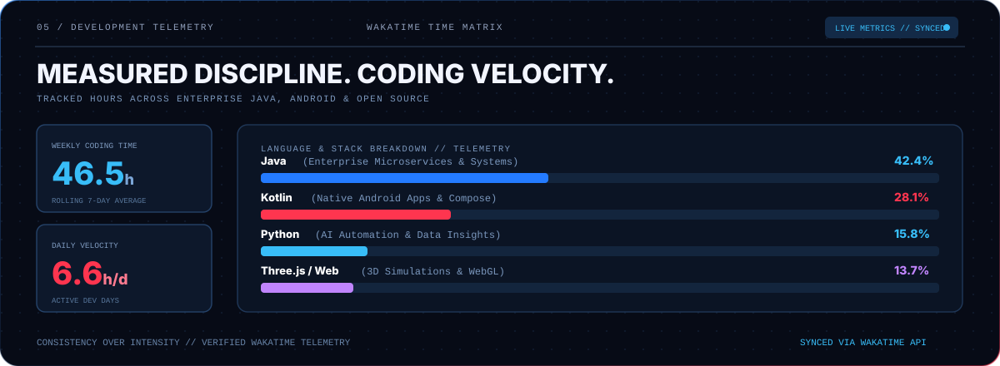

<!-- Bhaskar Acharjee GitHub Profile README -->
<!-- Designed in Redline Cyber Aesthetic (Ug0510 Theme) -->

<div align="center">
  
</div>

<p align="center">
  <a href="#the-blueprint"><b>[ 01 BLUEPRINT ]</b></a> &nbsp;·&nbsp;
  <a href="#engine-room"><b>[ 02 ENGINE ROOM ]</b></a> &nbsp;·&nbsp;
  <a href="#featured-projects"><b>[ 03 PROJECTS ]</b></a> &nbsp;·&nbsp;
  <a href="#snake-matrix"><b>[ 04 SNAKE MATRIX ]</b></a> &nbsp;·&nbsp;
  <a href="#wakatime-telemetry"><b>[ 05 WAKATIME ]</b></a> &nbsp;·&nbsp;
  <a href="#github-telemetry"><b>[ 06 GITHUB STATS ]</b></a> &nbsp;·&nbsp;
  <a href="#builder-credentials"><b>[ 07 CREDENTIALS ]</b></a> &nbsp;·&nbsp;
  <a href="#interactive-terminal"><b>[ 08 TERMINAL ]</b></a> &nbsp;·&nbsp;
  <a href="#start-conversation"><b>[ 09 CONNECT ]</b></a>
</p>

<!-- ================= 01 / HERO ================= -->
<p align="center">
  
</p>

<p align="center">
  
</p>

<!-- ================= 02 / THE BLUEPRINT ================= -->
<div id="the-blueprint" align="center">
  
</div>

<p align="center">
  
</p>

<!-- ================= 03 / THE ENGINE ROOM ================= -->
<div id="engine-room" align="center">
  
</div>

<!-- Interactive Tech Arsenal Badges -->
<p align="center">
  <a href="https://www.java.com/" target="_blank"></a>
  <a href="https://kotlinlang.org/" target="_blank"></a>
  <a href="https://www.python.org/" target="_blank"></a>
  <a href="https://spring.io/projects/spring-boot" target="_blank"></a>
  <a href="https://developer.android.com/jetpack/compose" target="_blank"></a>
  <a href="https://threejs.org/" target="_blank"></a>
  <a href="https://www.docker.com/" target="_blank"></a>
  <a href="https://aws.amazon.com/" target="_blank"></a>
  <a href="https://www.sqlite.org/" target="_blank"></a>
  <a href="https://leetcode.com/bhaskaracharjee" target="_blank"></a>
</p>

<p align="center">
  
</p>

<!-- ================= THINGS I'VE BUILT ================= -->
<div id="featured-projects">
  <h3>Things I've built</h3>

  | Project | What it does | Focus |
  | :--- | :--- | :--- |
  | [**3D-Room**](https://github.com/BhaskarAcharjee/3D-Room) | Interactive 3D animated room experience with camera perspective controls | 3D Web + Creative |
  | [**TShirtify**](https://github.com/BhaskarAcharjee/TShirtify) | AI-powered 3D T-shirt design simulator for visualizing custom apparel | AI + Three.js |
  | [**PassengerHub**](https://github.com/BhaskarAcharjee/PassengerHub) | Enterprise passenger management system built with Java, Servlets &amp; SQLite | Enterprise Java + DB |
  | [**TravelGenius**](https://github.com/BhaskarAcharjee/TravelGenius) | Intelligent travel companion with live weather integration &amp; route mapping | Full Stack + APIs |
  | [**MelodyMorph**](https://github.com/BhaskarAcharjee/MelodyMorph) | Real-time audio visualizer turning sound waves into dynamic visual symphonies | Web Audio + Canvas |
  | [**AIConverse**](https://github.com/BhaskarAcharjee/AIConverse) | Conversational AI platform powered by Python and modern LLM APIs | Python + AI |
</div>

<p align="center">
  
</p>

<!-- ================= 04 / CONTRIBUTION MATRIX // CYBER SNAKE ================= -->
<div id="snake-matrix" align="center">
  
  
  <p align="center">
    <picture>
      <source media="(prefers-color-scheme: dark)" srcset="https://raw.githubusercontent.com/BhaskarAcharjee/BhaskarAcharjee/output/github-contribution-grid-snake-dark.svg">
      <source media="(prefers-color-scheme: light)" srcset="https://raw.githubusercontent.com/BhaskarAcharjee/BhaskarAcharjee/output/github-contribution-grid-snake.svg">
      
    </picture>
  </p>
</div>

<p align="center">
  
</p>

<!-- ================= 05 / WAKATIME TELEMETRY MATRIX ================= -->
<div id="wakatime-telemetry" align="center">
  

  <p align="center">
    <a href="https://wakatime.com/@BhaskarAcharjee" target="_blank">
      
    </a>
  </p>
</div>

<p align="center">
  
</p>

<!-- ================= 06 / GITHUB GLOBAL TELEMETRY & STREAK ================= -->
<div id="github-telemetry" align="center">
  

  <p align="center">
    <a href="https://github.com/BhaskarAcharjee">
      
    </a>
    &nbsp;
    <a href="https://github.com/BhaskarAcharjee">
      
    </a>
  </p>

  <p align="center">
    
  </p>
</div>

<p align="center">
  
</p>

<!-- ================= 07 / BUILDER CREDENTIALS ================= -->
<div id="builder-credentials" align="center">
  
</div>

<p align="center">
  
</p>

<!-- ================= 08 / INTERACTIVE DEVELOPER CONSOLE ================= -->
<div id="interactive-terminal" align="center">
  
</div>

<br/>

<details>
  <summary><b>▶ [SYS_LOG] View Enterprise Microservices Architecture &amp; TCS Stack</b></summary>
  <br/>
  
  ```bash
  [SYSTEM TELEMETRY] Initializing TCS Core Microservices Infrastructure...
  ├── Runtime: OpenJDK 17 LTS / HotSpot VM (G1GC Optimized)
  ├── Framework: Spring Boot 3.x • Spring Cloud • Resilience4j Circuit Breaker
  ├── Architecture: Event-Driven Distributed Microservices • RESTful Endpoints
  ├── Data Layer: Hibernate JPA • Connection Pooling (HikariCP) • SQLite / MySQL
  ├── Reliability: Automated Failover • Zero-Downtime Hot Deployments • Docker Containers
  └── Status: 100% OPERATIONAL • High Throughput • Low Latency SLA Verified
  ```
</details>

<details>
  <summary><b>▶ [APK_STORE] View Published Google Play Store Applications (5+ Live)</b></summary>
  <br/>

  ```bash
  [PLAY_CONSOLE] Querying Google Play Developer Account...
  ├── Production Apps Live: 5+ Apps actively serving users
  ├── UI Toolkit: Jetpack Compose (Declarative, Reactive Material 3)
  ├── Architecture: MVVM Clean Architecture • Kotlin Coroutines & Flow
  ├── Persistence: Android Jetpack Room • SQLite Caching • Offline-First Sync
  └── Performance: Strict 60FPS UI rendering • Memory leak-free lifecycle management
  ```
</details>

<details>
  <summary><b>▶ [WEB_GL] View 3D Web Labs &amp; Audio Visualizer Demos</b></summary>
  <br/>

  ```bash
  [CREATIVE_LABS] Mounting WebGL 3D Canvas Context...
  ├── 3D-Room: Procedural room generation • OrbitControls • Dynamic shadows & camera rigs
  ├── TShirtify: Real-time texture projection • Canvas decal mapping • Fabric lighting
  ├── MelodyMorph: Fast Fourier Transform (FFT) • AudioContext real-time frequency analysis
  └── Deployed at: https://corvas.in • Zero external dependencies • Pure performance
  ```
</details>

<details>
  <summary><b>▶ [LEET_CODE] Algorithmic Problem Solving &amp; System Design Specs</b></summary>
  <br/>

  ```bash
  [ALGO_ENGINE] Querying LeetCode & CodeChef Competitive Profile...
  ├── Handle: https://leetcode.com/bhaskaracharjee
  ├── Core Categories: Dynamic Programming • Graphs & Trees • Two Pointers • Greedy
  ├── Philosophy: Understand the root constraints -> Model mathematically -> Optimize space/time
  └── Verification: All test cases passed with clean asymptotic complexity
  ```
</details>

<p align="center">
  
</p>

<!-- ================= 09 / START A CONVERSATION ================= -->
<div id="start-conversation" align="center">
  
</div>

<p align="center">
  <a href="https://www.linkedin.com/in/bhaskar-acharjee/" target="_blank"></a> &nbsp;
  <a href="https://youtube.com/@CorvasBhaskar" target="_blank"></a> &nbsp;
  <a href="https://corvas.in" target="_blank"></a> &nbsp;
  <a href="https://twitter.com/_bha_s_kar_" target="_blank"></a> &nbsp;
  <a href="https://leetcode.com/bhaskaracharjee" target="_blank"></a> &nbsp;
  <a href="mailto:bhaskaracharjee2002@gmail.com"></a>
</p>

<p align="center">
  <sub>Curious by default. Building with intent.</sub>
</p>
