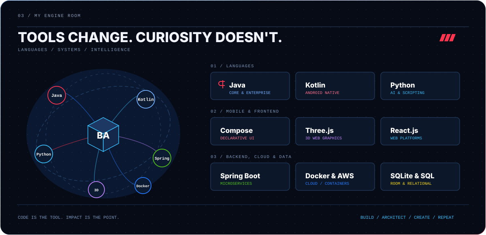
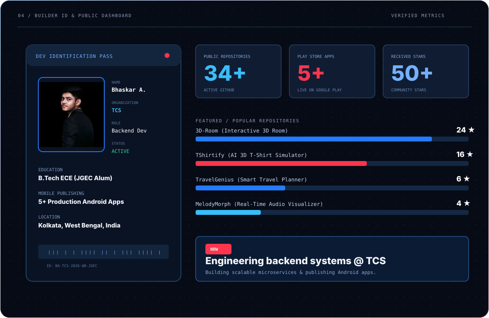

<!-- Bhaskar Acharjee GitHub Profile README -->

  

### Things I've built

| Project | What it does | Focus |
| :--- | :--- | :--- |
| [**3D-Room**](https://github.com/BhaskarAcharjee/3D-Room) | Interactive 3D animated room experience with camera perspective controls | 3D Web + Creative |
| [**TShirtify**](https://github.com/BhaskarAcharjee/TShirtify) | AI-powered 3D T-shirt design simulator for visualizing custom apparel | AI + Three.js |
| [**PassengerHub**](https://github.com/BhaskarAcharjee/PassengerHub) | Enterprise passenger management system built with Java, Servlets &amp; SQLite | Enterprise Java + DB |
| [**TravelGenius**](https://github.com/BhaskarAcharjee/TravelGenius) | Intelligent travel companion with live weather integration &amp; route mapping | Full Stack + APIs |
| [**MelodyMorph**](https://github.com/BhaskarAcharjee/MelodyMorph) | Real-time audio visualizer turning sound waves into dynamic visual symphonies | Web Audio + Canvas |
| [**AIConverse**](https://github.com/BhaskarAcharjee/AIConverse) | Conversational AI platform powered by Python and modern LLM APIs | Python + AI |

  <a href="https://www.linkedin.com/in/bhaskar-acharjee/" target="_blank">LinkedIn</a> &nbsp;·&nbsp;
  <a href="https://twitter.com/_bha_s_kar_" target="_blank">Twitter / X</a> &nbsp;·&nbsp;
  <a href="https://youtube.com/@CorvasBhaskar" target="_blank">YouTube — CorvasBhaskar</a> &nbsp;·&nbsp;
  <a href="https://corvas.in" target="_blank">Portfolio — corvas.in</a> &nbsp;·&nbsp;
  <a href="https://leetcode.com/bhaskaracharjee" target="_blank">LeetCode</a> &nbsp;·&nbsp;
  <a href="mailto:bhaskaracharjee2002@gmail.com">Email</a>

Curious by default. Building with intent.

