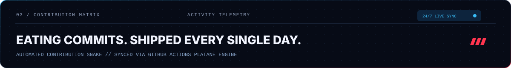
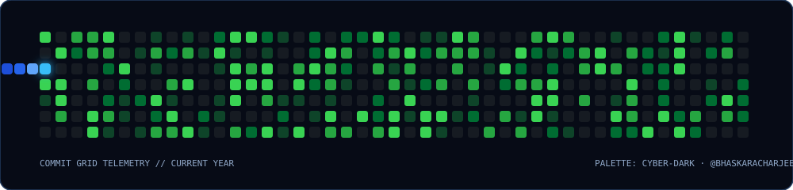
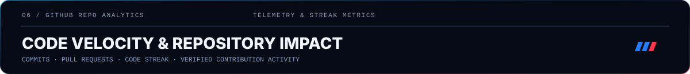
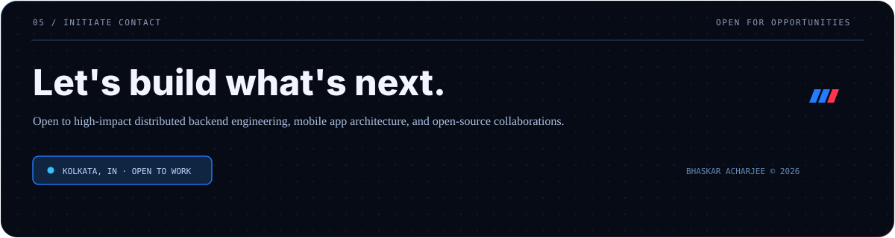

<!-- Bhaskar Acharjee GitHub Profile README -->
<!-- Designed in Redline Cyber Aesthetic (Ug0510 Theme) -->

  

  <a href="#the-blueprint"><b>[ 01 BLUEPRINT ]</b></a> &nbsp;·&nbsp;
  <a href="#engine-room"><b>[ 02 ENGINE ROOM ]</b></a> &nbsp;·&nbsp;
  <a href="#snake-matrix"><b>[ 03 SNAKE MATRIX ]</b></a> &nbsp;·&nbsp;
  <a href="#wakatime-telemetry"><b>[ 04 WAKATIME ]</b></a> &nbsp;·&nbsp;
  <a href="#github-telemetry"><b>[ 05 GITHUB STATS ]</b></a> &nbsp;·&nbsp;
  <a href="#builder-credentials"><b>[ 06 CREDENTIALS ]</b></a> &nbsp;·&nbsp;
  <a href="#interactive-terminal"><b>[ 07 TERMINAL ]</b></a> &nbsp;·&nbsp;
  <a href="#start-conversation"><b>[ 08 CONNECT ]</b></a>

<!-- ================= 01 / HERO ================= -->

  

  

<!-- ================= 02 / THE BLUEPRINT ================= -->

  

  

<!-- ================= 03 / THE ENGINE ROOM ================= -->

  

<!-- Interactive Tech Arsenal Badges -->

  
  
  
  
  
  
  
  
  
  
  

  

<!-- ================= 04 / CONTRIBUTION MATRIX // CYBER SNAKE ================= -->

  
  
  

    <picture>
      <source media="(prefers-color-scheme: dark)" srcset="https://raw.githubusercontent.com/BhaskarAcharjee/BhaskarAcharjee/output/github-contribution-grid-snake-dark.svg">
      <source media="(prefers-color-scheme: light)" srcset="https://raw.githubusercontent.com/BhaskarAcharjee/BhaskarAcharjee/output/github-contribution-grid-snake.svg">
      
    </picture>
  

  

<!-- ================= 04 / WAKATIME TELEMETRY MATRIX ================= -->

  

  

<!-- ================= 06 / GITHUB GLOBAL TELEMETRY & STREAK ================= -->

  

  

    
    &nbsp;
    
  

  

<!-- ================= 07 / BUILDER CREDENTIALS ================= -->

  

  

<!-- ================= 08 / INTERACTIVE DEVELOPER CONSOLE ================= -->

  

  

<!-- ================= 09 / START A CONVERSATION ================= -->

  

   &nbsp;
   &nbsp;
   &nbsp;
   &nbsp;
   &nbsp;
  

  Curious by default. Building with intent.

